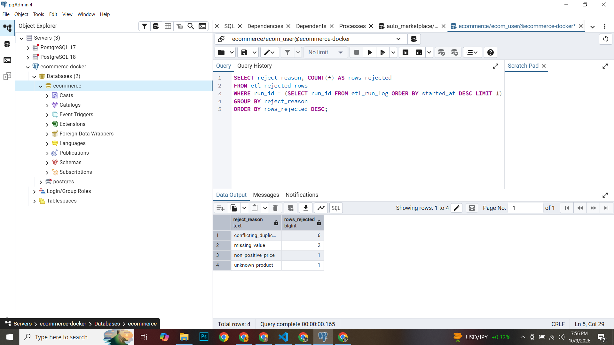
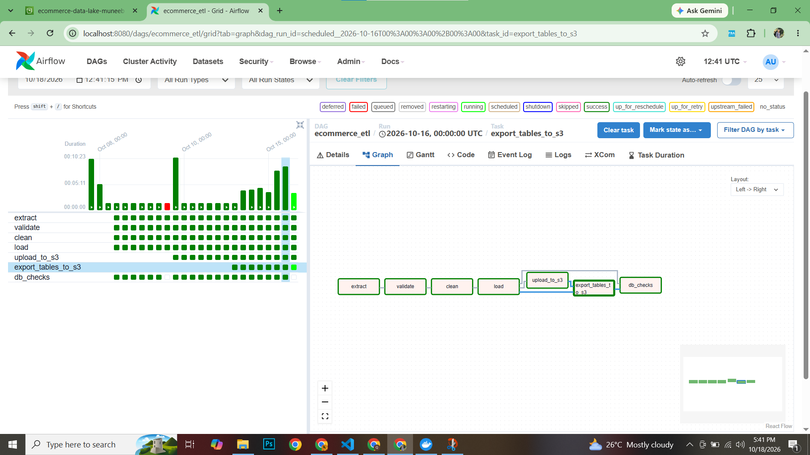
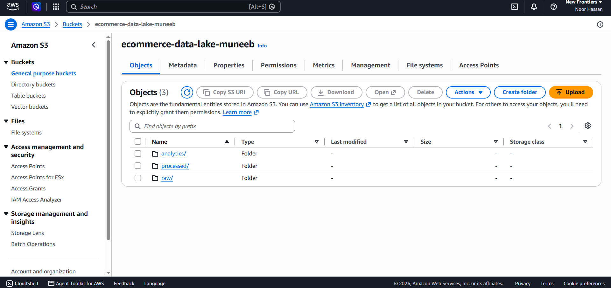
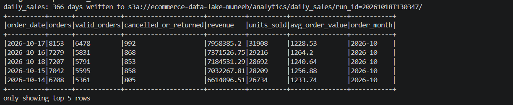
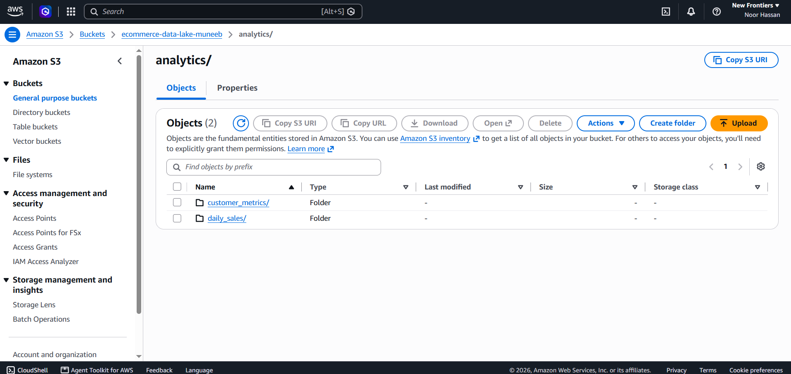

# E-Commerce Data Platform


A production-style batch data platform for an e-commerce domain. It ingests product price updates (CSV) and currency exchange rates (API), validates and cleans them, loads the trusted rows into PostgreSQL, keeps every rejected row with a reason, and copies each run's data to an AWS S3 data lake. The main database tables (users, orders, order items, events, ...) are exported to S3 as Parquet, and PySpark jobs turn them into analytics datasets. The pipeline is orchestrated by Apache Airflow and runs in Docker.

**Stack:** Python · pandas · PostgreSQL 17 · Apache Airflow · AWS S3 (boto3) · Parquet (pyarrow) · PySpark · Docker Compose · pytest · GitHub Actions

## Architecture

```
CSV price updates ──┐
                    ├─► Validate ─► Clean ─► Load ─► PostgreSQL
FX rates API ───────┘      │          │         │      ├─ product_price_history
                           │          │         │      ├─ fx_rates
                           │          └─ rejects ──────┴─ etl_rejected_rows (with reason)
                           │                            └─ etl_run_log (one row per run)
                           │
                           └─ issues reported         ─► Upload ─► AWS S3 data lake
                                                                   ├─ raw/        (CSV + Parquet table snapshots)
PostgreSQL tables ─► Export (Parquet) ───────────────────────────► ├─ processed/
(users, orders, order_items, events, ...)                          └─ analytics/  (PySpark output)
                                                                         ▲
                                                  PySpark (Docker) ──────┘
                                                  reads raw/, writes analytics/

Orchestration: Airflow DAG (scheduler + webserver, LocalExecutor)
```

Pipeline steps live in separate modules so each can be tested on its own:

| Step | Module | What it does |
|------|--------|--------------|
| Validate | `src/transformation/validate.py` | Finds problems and reports them as `Issue` objects. Never changes data. |
| Clean | `src/transformation/clean.py` | Normalises text, converts types, drops exact duplicates, splits rows into clean and rejected. |
| Load | `src/loading/load.py` | Writes to PostgreSQL. Every function is idempotent. |
| Upload | `src/loading/s3.py` | Writes the run's raw, clean, rejected and FX data to S3, partitioned by day and run. |
| Export | `src/loading/export_to_s3.py` | Streams every main table from PostgreSQL to S3 as Parquet, in chunks. |
| Spark jobs | `spark/jobs/` | `daily_sales.py` and `customer_metrics.py` build the analytics datasets. |

## Data quality and rejected rows

Nothing is silently dropped. Every rejected row is stored in `etl_rejected_rows` with its `run_id` and a `reject_reason`:

| Reason | Meaning |
|--------|---------|
| `missing_value` | A required field is empty or could not be parsed (price, date, ...) |
| `non_positive_price` | Price is zero or negative |
| `unknown_product` | `product_id` does not exist in the products table |
| `conflicting_duplicate` | Same product and date with different prices, so all copies are rejected |

Rejected rows from the latest run:



## Idempotency

Re-running the pipeline never creates duplicates:

- `fx_rates` and `product_price_history` use `INSERT ... ON CONFLICT DO UPDATE`.
- `etl_run_log` uses `ON CONFLICT (run_id) DO UPDATE`.
- `load_rejected` deletes the rejects of the same `run_id` and source before inserting, so an Airflow retry does not double the rows. Rejects of different runs are kept as history.
- S3 keys contain the `run_id`, so uploading or exporting the same run again overwrites the same files.

## Orchestration

The Airflow DAG `ecommerce_etl` runs daily with retries and logging. It has seven tasks:

`extract → validate → clean → load → upload_to_s3 → export_tables_to_s3 → db_checks`



## Data lake (AWS S3)

The bucket has three zones. Every run writes to its own `run_id`, partitioned by day:

```
raw/price_updates/dt=YYYY-MM-DD/run_id=<id>/product_price_updates.csv
raw/<table>/dt=YYYY-MM-DD/run_id=<id>/<table>.parquet          # users, orders, order_items, events, ...
processed/price_updates/dt=YYYY-MM-DD/run_id=<id>/clean.csv
processed/price_updates_rejected/dt=YYYY-MM-DD/run_id=<id>/rejected.csv
processed/fx_rates/dt=YYYY-MM-DD/run_id=<id>/fx_rates.csv
analytics/daily_sales/run_id=<id>/order_month=YYYY-MM/*.parquet
analytics/customer_metrics/run_id=<id>/*.parquet
```

- The `run_id` is the same one stored in `etl_run_log` and `etl_rejected_rows`, so any run can be traced from the database to its files in S3.
- The bucket is private (public access blocked). Credentials are read from environment variables, never from code.
- The IAM user has a least-privilege policy limited to this one bucket (list, get, put, delete objects).
- `src/utils/s3_smoke_test.py` checks that the credentials can reach the bucket.



## Big data: 1 million orders

`src/ingestion/generate_data.py` creates realistic fake data (users, sellers, products, orders, order items, payments, reviews, events). It loads big tables with `COPY` and builds orders in chunks, so memory stays small.

```powershell
# default size (5,000 orders)
python -m src.ingestion.generate_data --reset

# big data: 1M orders, ~2.5M order items, 3M events
python -m src.ingestion.generate_data --reset --users 100000 --sellers 500 --products 5000 --orders 1000000 --reviews 300000 --events 3000000
```

The export step reads each table with a server-side cursor in chunks of 100,000 rows and writes one Parquet file per table (the largest, `events.parquet`, is about 66 MB).

## PySpark analytics

Two Spark jobs read the newest raw snapshot from S3 and write Parquet to the `analytics/` zone:

| Job | Output |
|-----|--------|
| `daily_sales.py` | Per day: orders, valid orders, cancelled/returned, revenue, units sold, average order value. Partitioned by month. |
| `customer_metrics.py` | Per customer: orders, spend, first/last order, average order value, repeat-customer flag. |

Revenue counts only `delivered`, `shipped` and `paid` orders. Spark runs in its own Docker image (Java and the S3 connector are inside it), so nothing has to be installed on the host:

```powershell
docker compose -f docker-compose.spark.yml build
docker compose -f docker-compose.spark.yml run --rm spark /opt/spark/bin/spark-submit --driver-memory 2g /opt/project/spark/jobs/daily_sales.py
docker compose -f docker-compose.spark.yml run --rm spark /opt/spark/bin/spark-submit --driver-memory 2g /opt/project/spark/jobs/customer_metrics.py
```



## Project structure

```
ecommerce-data-platform/
├── airflow/dags/          # Airflow DAG definitions
├── docker/airflow/        # Airflow image (Dockerfile)
├── docker/spark/          # Spark image (Dockerfile, includes S3 connector jars)
├── spark/jobs/            # PySpark jobs: common.py, daily_sales.py, customer_metrics.py
├── sql/                   # Schema and ETL table scripts (run on first DB start)
├── src/
│   ├── ingestion/         # CSV and API readers, data generator
│   ├── transformation/    # validate.py, clean.py
│   ├── loading/           # load.py (PostgreSQL), s3.py, export_to_s3.py
│   └── utils/             # DB connection, S3 smoke test
├── tests/                 # pytest unit tests
├── docs/images/           # README screenshots
├── data/                  # Local input data
├── .github/workflows/     # CI (GitHub Actions)
├── docker-compose.yml         # PostgreSQL + Airflow
├── docker-compose.spark.yml   # Spark jobs
├── .env.example
└── requirements.txt
```

## Getting started

**Requirements:** Docker Desktop, Python 3.12+, Git, and an AWS account with an S3 bucket and an IAM user (for the S3 steps).

```powershell
git clone https://github.com/Muneeb0376/ecommerce-data-platform.git
cd ecommerce-data-platform

# 1. Configuration
copy .env.example .env      # then edit .env: passwords, secret key, AWS keys, bucket name

# 2. Start PostgreSQL and Airflow
docker compose up -d --build
docker compose ps
```

- Airflow UI: <http://localhost:8080> (log in with `AIRFLOW_ADMIN_USER` / `AIRFLOW_ADMIN_PASSWORD` from your `.env`)
- PostgreSQL: `localhost:<POSTGRES_PORT>` (database `ecommerce`)
- Schema scripts in `sql/` run automatically the first time the database volume is created.

Open the Airflow UI, enable the DAG and click **Trigger DAG**. To check the S3 connection on its own:

```powershell
python src/utils/s3_smoke_test.py
```

To export the tables to S3 without Airflow: `python -m src.loading.export_to_s3`.

## Running the tests

```powershell
python -m venv .venv
.\.venv\Scripts\Activate.ps1
pip install -r requirements.txt
pytest -v
```

The tests cover the cleaning rules, every validation check, the database checks (with a fake connection) and the S3 helpers (with a fake client), so no running database or AWS account is needed. They also run automatically on every push through GitHub Actions.

## Useful queries

Rejected rows of the latest run:

```sql
SELECT reject_reason, COUNT(*) AS rows_rejected
FROM etl_rejected_rows
WHERE run_id = (SELECT run_id FROM etl_run_log ORDER BY started_at DESC LIMIT 1)
GROUP BY reject_reason
ORDER BY rows_rejected DESC;
```

Run history:

```sql
SELECT run_id, status, rows_loaded, rows_rejected, message
FROM etl_run_log
ORDER BY started_at DESC
LIMIT 5;
```

## Security

Secrets (database passwords, Airflow secret key, AWS access keys) are read from environment variables. `.env` is git-ignored and only `.env.example` with placeholders is committed. The IAM user used by the pipeline is separate from the AWS root account and can only access the data-lake bucket.

## Roadmap

- [x] Python + PostgreSQL + ETL with data-quality checks
- [x] Airflow orchestration in Docker
- [x] Unit tests and CI (GitHub Actions)
- [x] AWS S3 data lake (raw / processed / analytics)
- [x] Database tables exported to S3 as Parquet
- [x] Data generator scaled to 1M orders
- [x] PySpark jobs (daily_sales, customer_metrics)
- [ ] Spark jobs triggered from Airflow
- [ ] Data warehouse (star schema) and Power BI dashboards
- [ ] Kafka and Spark Streaming for real-time events